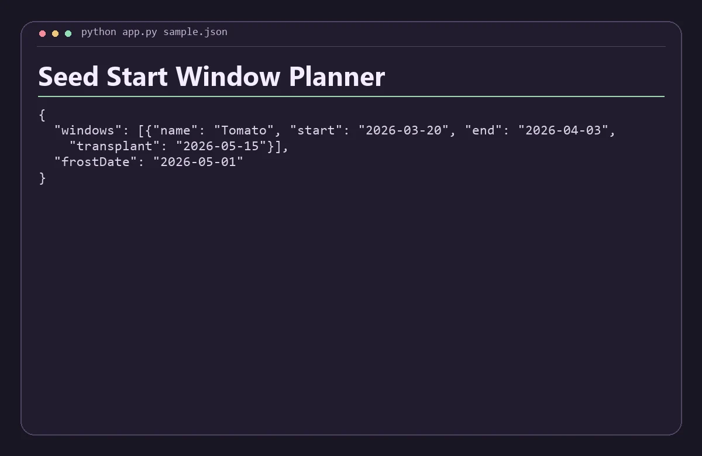

# Seed Start Window Planner

Turn your local frost date and seed-packet offsets into a sowing and transplant calendar.



## Run

Install Python 3.11 or newer. Run these commands from the repository root.

```sh
python app.py sample.json
```

Replace `sample.json` with a JSON file following the same structure. The app prints a JSON report to standard output.

Provide an ISO calendar date and each crop's two indoor-start offsets in days before that date. A nonnegative transplant delay places the transplant date on or after the frost date. Choose your own local date and packet guidance.

## Verify

Run `python check.py` with Python 3.11 or newer after the build step when applicable. The check verifies the bundled scenario and confirms that an invalid input returns an error.
